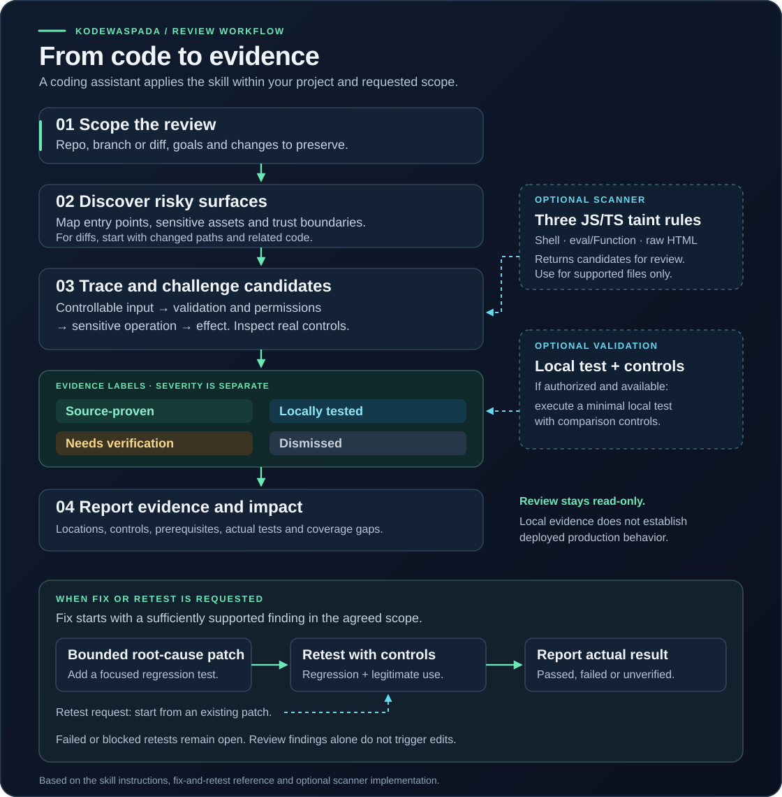
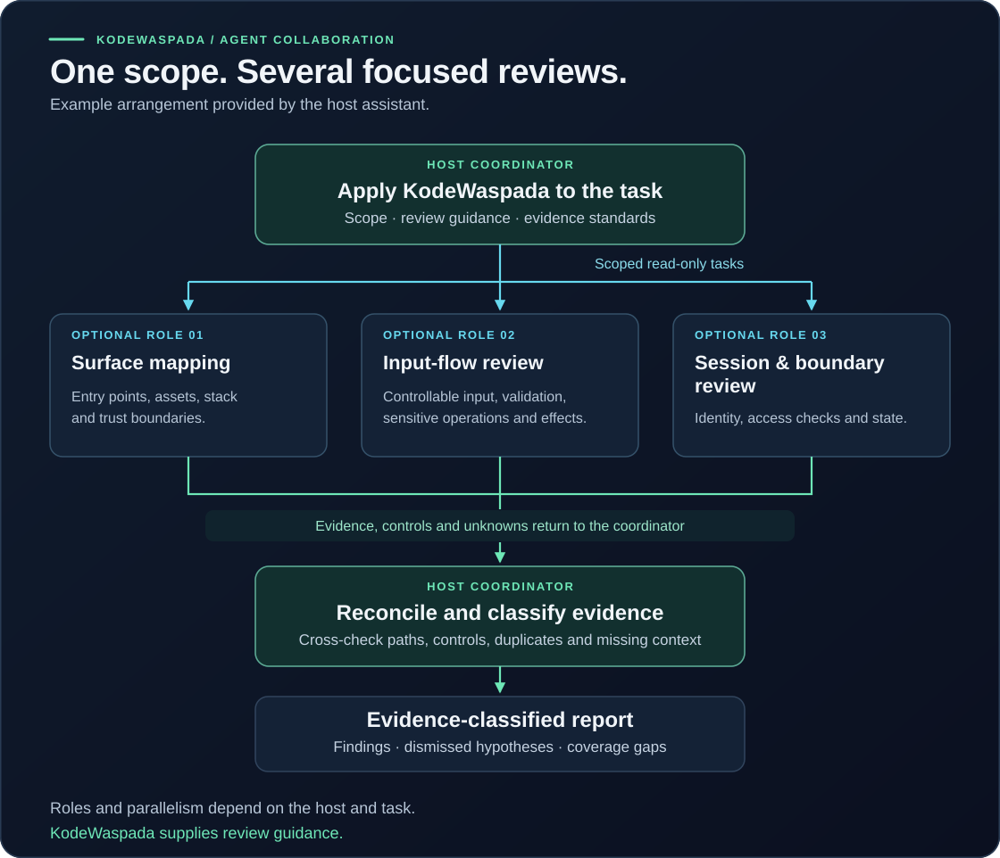

# KodeWaspada

**Evidence-first security review for developers building with AI coding agents.**

[**Bahasa Indonesia**](README.id.md)

KodeWaspada is an actively developed **open-source blue-team security review agent/skill** for OpenAI Codex and coding assistants that support compatible Agent Skills. It is designed to make code-security review less dependent on confident-sounding guesses and more dependent on traceable evidence.

Created and maintained by **[EL1Syum (@gustiakmal52)](https://github.com/gustiakmal52)**. Free to use, modify, and distribute, including commercially, under Apache License 2.0 starting with `0.3.0`.

The core workflow is:

**issue → location → evidence → impact → fix → retest**

KodeWaspada is an independent community project. It is not an official OpenAI or Daybreak product, certification, endorsement, or security guarantee.

## Why KodeWaspada

A generic "act as a security expert" prompt can produce useful ideas, but it does not define how the agent should distinguish a real vulnerability from a plausible-looking false positive.

KodeWaspada gives the agent a repeatable decision process:

- **Evidence-first:** follow controllable input through validation/authorization to the sensitive operation and effect.
- **Focused review passes:** map the risky surface first, then prove the highest-impact candidates instead of scanning every folder equally.
- **False-positive aware:** real controls can invalidate a finding and should be documented when they do.
- **Fix-aware:** patch the root cause only when a fix is requested.
- **Retest-aware:** do not claim success until relevant tests are actually run.
- **Prompt-injection resistant review behavior:** instructions embedded inside reviewed source, comments, logs, issues, or scanner output are treated as data, not permission.
- **Explicit evidence states:** source-proven, locally tested, needs verification, or dismissed.

## Performance: focused review, measured scanner

The skill instructs the agent to start a diff review at changed code, then follow connected callers, guards, and sensitive operations. For a whole repository, it calls for one risk map before deeper analysis of the strongest candidates. Detailed review patterns are read for relevant areas. The optional scanner can target a relevant JS/TS folder; its report must state that narrower coverage.

On one Linux laptop (Intel i5-1155G7, Python 3.14.7, Semgrep CE 1.179.0), five local runs of the included five-file fixture each scanned all five files and returned 20 candidates. Median scanner time with the current timing field was **2.376 s** (range **2.277–2.626 s**). The duration appears in CLI, JSON, HTML, and Markdown reports. [Method and limits](docs/QA.md#performance-check). This measures the optional scanner on synthetic files, not agent review time, a speedup, or performance across other projects.

## 30-second quick start

The only required component is [skills/kodewaspada](skills/kodewaspada). Python and Semgrep are **not required** to use the skill.

From this repository:

~~~bash
mkdir -p /path/to/your-project/.agents/skills
cp -R -i skills/kodewaspada /path/to/your-project/.agents/skills/
~~~

Then start a new coding-agent session and ask:

~~~text
$kodewaspada Review this project before deployment.
Focus on authentication, cross-user data access, and dangerous input flows.
Show evidence, impact, and uncertainty. Do not modify code yet.
~~~

The folder follows the Agent Skills structure used by current OpenAI tooling. Host-specific installation paths can differ, so review the skill before enabling it in your environment.

## What it does

| Mode | Expected behavior |
| --- | --- |
| Threat mapping | Identify sensitive assets, actors, trust boundaries, and unknown areas |
| Code / diff review | Trace input → validation/authorization → sensitive operation → effect |
| Finding triage | Separate source evidence, local test evidence, unresolved hypotheses, and dismissed findings |
| Fix | Apply a small root-cause patch while preserving unrelated user changes |
| Retest | Run relevant regression checks and report actual results and remaining gaps |

Review guidance covers authentication/session handling, object/tenant/RLS authorization, injection, XSS, files/uploads, SSRF, secrets, dependencies, CI/configuration, AI-tool boundaries, and business logic.

That is **review scope**, not a claim that every category is automatically detected.

## Evidence model

KodeWaspada intentionally separates confidence from impact.

| Evidence state | Meaning |
| --- | --- |
| **Source-proven** | The source-to-effect path and relevant control are visible in reviewed code |
| **Locally tested** | A local test or PoC was actually executed with a meaningful comparison control |
| **Needs verification** | A plausible path exists, but required helper/config/runtime/permission evidence is missing |
| **Dismissed** | A real control breaks the suspected path; it should not remain in the active finding count |

A source-level finding is not automatically a production exploit. A clean result is not a security certificate.

## Example: authorization review

Suppose user A can request a note belonging to user B.

KodeWaspada should not stop at "the URL contains an ID." It should trace the request through middleware and the data query, inspect ownership checks, and distinguish code evidence from runtime evidence.

If the query already binds the object to the authenticated owner, the suspected cross-user access issue should be **dismissed**, not reported just because the route looked suspicious.

## Three common workflows

**1. Review without editing**

~~~text
$kodewaspada Review this application folder.
Focus on login, cross-user data access, and database/HTML input.
Show evidence and limitations. Do not edit files.
~~~

**2. Fix a sufficiently supported finding**

~~~text
$kodewaspada Fix the cross-user data-access issue we just confirmed.
Preserve the public API and my unrelated changes.
Add owner vs. non-owner regression tests.
~~~

**3. Retest the patch**

~~~text
$kodewaspada Retest this patch.
Run the relevant local tests, compare allowed and denied access,
and report the actual results.
~~~

A review request does not automatically authorize edits, deployment, publishing, opening PRs, or production testing.

## Optional deterministic scanner

KodeWaspada also includes an optional Python CLI that can run without AI. It currently provides **three JavaScript/TypeScript taint checks** for request-controlled input reaching:

- shell execution,
- eval / Function,
- raw HTML output.

It generates HTML, Markdown, and JSON reports.

~~~bash
python3 -m kodewaspada scan /path/to/project --out outputs/first-review
~~~

The scanner is a candidate finder, not the full security review. A zero-result scan does not mean the project is safe.

See [docs/SCANNER.md](docs/SCANNER.md) for supported extensions, limits, privacy behavior, exit codes, and current engine constraints.

## Evaluation philosophy

The repository includes synthetic evaluation fixtures for testing **agent decisions**, not just scanner syntax.

Current eval scenarios check whether the agent can:

- identify missing ownership binding,
- avoid reporting a safe owner-bound query,
- avoid inventing XSS when data goes through textContent,
- refuse to guess about unavailable authorization helpers,
- distinguish raw SQL construction from parameter binding,
- avoid false shell-injection claims when execFile is used with fixed binaries and separate arguments,
- identify unsafe file-path containment while dismissing the canonical-path control,
- ignore malicious instructions embedded in reviewed comments,
- keep read-only review read-only.

See [evals/README.md](evals/README.md).

These fixtures are not a universal benchmark, an accuracy percentage, or proof that the skill has no false negatives. Material instruction changes should be reevaluated.

### Authorized private-repository pilot

On one authorized private application checkout, the skill-led manual review found a file-boundary flaw and validated the behavior locally with a synthetic marker. No secret was accessed and no production behavior was claimed. Separately, a fresh evaluator correctly distinguished the equivalent vulnerable and safe functions in the public synthetic fixture.

The optional JS/TS scanner reported zero candidates within its supported frontend scope. That distinction is intentional: the finding came from manual agent review, not from pretending three JS/TS rules cover an entire application. One pilot demonstrates a useful workflow, not cross-repository accuracy. Application identity and exploit details remain private pending remediation.

## Security and privacy boundaries

- The skill has no KodeWaspada backend.
- Source read by your coding assistant may still be processed by that assistant's provider.
- Do not place credentials, production dumps, client source, or live vulnerability details in public issues or fixtures.
- Local source analysis, local testing, and production behavior are different evidence levels.
- The optional scanner does not automatically inspect every vulnerability class.
- Live testing, deployment, credential rotation, or publication requires separate authorization.

Potential vulnerabilities in **KodeWaspada itself** should follow the private reporting process in [SECURITY.md](SECURITY.md).

## Run the test suite

~~~bash
python3 -m unittest discover -s tests -v
python3 -m compileall -q kodewaspada
~~~

Full scanner coverage requires the documented Semgrep dependency. See [docs/SCANNER.md](docs/SCANNER.md) and [docs/QA.md](docs/QA.md).

## Contributing

External review, pull requests, and proposals are welcome, especially when they improve the evidence model rather than merely increasing the number of warnings. Contributions use Apache License 2.0, and contributors retain their copyright. See [CONTRIBUTING.md](CONTRIBUTING.md).

Useful proposals include:

- synthetic positive and negative security cases,
- false-positive reductions,
- evaluation cases where a hypothesis should be dismissed,
- review guidance for real framework authorization patterns,
- scanner rules with positive **and** negative fixtures,
- documentation and cross-assistant compatibility testing.

Read [CONTRIBUTING.md](CONTRIBUTING.md) before submitting changes.

For discussion, see the open feedback issue: [real-world AppSec review cases](https://github.com/gustiakmal52/kodewaspada/issues/1).

If KodeWaspada improves your security-review workflow, consider **starring the repository** so other developers can find it.

## Commercial use

Starting with `0.3.0`, companies, consultancies, and paid products can use KodeWaspada under Apache License 2.0 without purchasing a license or requesting separate permission. Commercial redistribution is allowed under the same license obligations.

Paid onboarding, customization, or support can be agreed separately; none is required to use the project, and no support or SLA is included by default. See [commercial use and earlier releases](COMMERCIAL-LICENSING.md).

## License

Starting with `0.3.0`, KodeWaspada's original instructions, wrapper, rules, examples, and documentation are available under [Apache License 2.0](LICENSE):

~~~text
Copyright 2026 EL1Syum
~~~

You may use, modify, and redistribute the project, including in commercial products. When redistributing, include [LICENSE](LICENSE), retain applicable attribution and [NOTICE](NOTICE) content, and identify modified files as required by Apache-2.0. The license does not grant trademark rights or imply endorsement. Earlier releases retain the license shipped with them; see [the transition note](COMMERCIAL-LICENSING.md).

Semgrep is a separate upstream dependency and is not bundled as the project's own engine.

---

**Created and maintained by:** [EL1Syum (@gustiakmal52)](https://github.com/gustiakmal52)

---

## Visual workflow

The coding assistant applies the skill to the requested scope: discover risky surfaces, trace input through real controls to an effect, classify the evidence, and report impact and coverage. Local validation depends on authorization and an available test environment. Fix and Retest follow the requested mode.

The four evidence labels describe what is supported; they are separate from severity. The optional JS/TS scanner supplies candidates for review through three rules: shell execution, `eval` / `Function`, and raw HTML output.

### Example agent collaboration

This shows one way a host coding assistant can distribute review work when it supports multiple agents. Roles, scheduling, and tool access come from the host; KodeWaspada provides the review guidance and evidence standard. A single coding assistant can use the same skill.

See the [visual guide and source map](docs/VISUAL-WORKFLOW.md) for the text equivalents, requested Fix/Retest paths, and the implemented scanner pipeline. [Panduan Bahasa Indonesia](docs/VISUAL-WORKFLOW.id.md).
