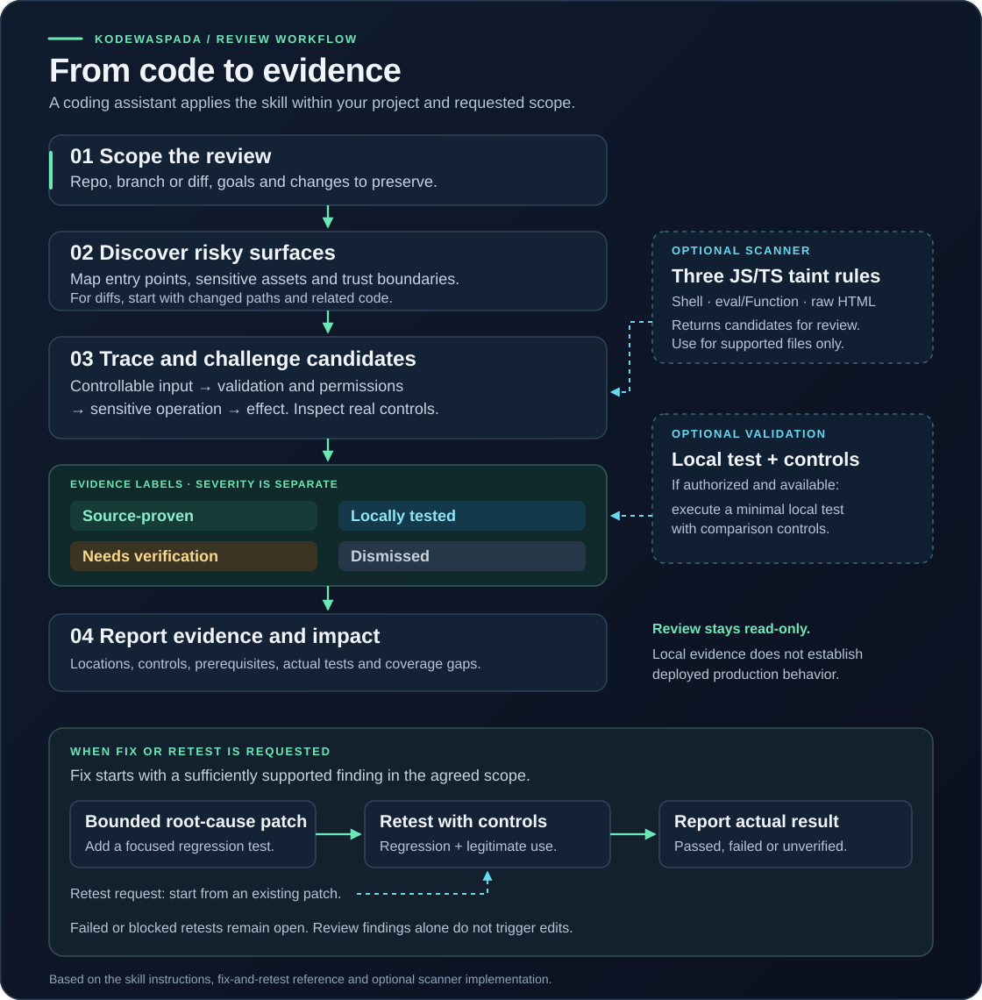

# Alur visual dan peta sumber

[English](VISUAL-WORKFLOW.md)

Diagram ini menjelaskan alur yang didefinisikan di repositori. Peta sumber di bawah diperiksa terhadap commit [`a6308e1`](https://github.com/gustiakmal52/kodewaspada/tree/a6308e18d3aedd203dc228f794f91e5b19213088). Setiap diagram dilengkapi penjelasan teks agar tetap dapat dipahami tanpa melihat gambar.

## 1. Review, bukti, dan tindak lanjut yang diminta

Coding assistant membaca skill KodeWaspada dan memakai alat yang tersedia dalam sesinya. Skill menyediakan proses review dan standar bukti. Python serta Semgrep bersifat opsional untuk alur utama ini.

| Tahap | Pekerjaan | Hasil |
| --- | --- | --- |
| Tetapkan tugas | Kenali mode yang diminta, repo atau folder, branch atau diff, tujuan, serta perubahan pengguna yang harus dipertahankan. Permintaan umum untuk mengecek keamanan dimulai dalam mode Review. | Scope dan tindakan yang diizinkan. |
| Petakan permukaan berisiko | Petakan entrypoint, aset sensitif, role, dan batas kepercayaan. Untuk diff, ikuti jalur berubah ke caller, middleware, konfigurasi, dan sink terkait. | Kandidat yang diprioritaskan dan catatan cakupan. |
| Telusuri dan uji dugaan | Ikuti input yang dapat dikendalikan melalui transformasi, validasi, pemeriksaan izin, operasi sensitif, hingga efek. Baca implementasi helper dan periksa kontrol yang dapat menggugurkan dugaan. | Alur yang didukung bukti, kekurangan bukti yang spesifik, atau alasan kandidat gugur. |
| Validasi lokal bila diizinkan dan tersedia | Jalankan tes sintetis minimal dengan kontrol pembanding yang bermakna. Catat efek dan hasil aktual. | Bukti lokal untuk perilaku yang diuji. |
| Laporkan | Jelaskan status bukti, lokasi source aktual, dampak yang didukung, prasyarat, kontrol, arahan perbaikan akar masalah, hasil uji, dan area yang belum diperiksa. | Review yang dapat ditindaklanjuti beserta ketidakpastiannya. |

### Status bukti terpisah dari tingkat risiko

Empat label ini menjelaskan bukti yang tersedia; bukan empat tahap berurutan yang wajib dilalui.

| Label pada gambar | Arti |
| --- | --- |
| **Source-proven — terbukti di kode** | Source yang dibaca membuktikan alur input hingga efek dan kontrol terkait. Perilaku runtime atau produksi mungkin belum diuji. |
| **Locally tested — terbukti lewat uji lokal** | Tes lokal benar-benar dijalankan dan mencatat efek serta kontrol pembanding yang bermakna. |
| **Needs verification — perlu verifikasi** | Kandidat masuk akal, tetapi bukti helper, konfigurasi, izin, runtime, atau efek yang diperlukan belum lengkap. Laporan menyebutkan kekurangannya. |
| **Dismissed — gugur** | Kontrol nyata memutus dugaan dan jalur alternatif yang relevan telah dipertimbangkan. Kandidat dikeluarkan dari jumlah temuan aktif. |

Dampak dan prioritas dinilai tersendiri berdasarkan keterjangkauan serta konsekuensi yang didukung bukti. Temuan source maupun tes lokal yang lulus belum membuktikan perilaku deployment produksi.

### Fix dan Retest mengikuti mode yang diminta

Saat **Fix** diminta, asisten memeriksa apakah temuan masih berlaku pada checkout sekarang, membaca caller serta kontrak terkait, lalu menerapkan patch akar masalah dalam scope dengan pengujian regresi. Bukti kandidat yang belum cukup perlu diselesaikan sebelum perilaku aplikasi diubah.

Saat **Retest** diminta, asisten dapat mulai dari patch yang sudah ada. Asisten menjalankan regresi dan kontrol penggunaan yang sah, lalu melaporkan hasil aktual. Retest yang gagal mengarah ke perbaikan lanjutan dalam scope atau masalah yang masih terbuka; tes yang belum tersedia tetap belum terverifikasi. Review sendiri bersifat read-only. Threat mapping dan hardening merupakan mode lain yang dapat diminta; saran penguatan dipisahkan dari kerentanan terbukti.

## 2. Kolaborasi bila host mendukung beberapa agent

Ini adalah **contoh susunan kerja yang disediakan oleh coding assistant host**. Jumlah agent, peran, penjadwalan, dan akses alat bergantung pada host serta tugasnya. Repositori menyediakan instruksi skill; `agents/openai.yaml` menyediakan metadata antarmuka. Ilustrasi ini tidak menambahkan runtime orkestrasi.

| Contoh peran | Tugas dalam scope | Bahan yang dikembalikan ke koordinator |
| --- | --- | --- |
| Pemetaan permukaan | Periksa entrypoint, stack, aset sensitif, batas kepercayaan, dan instruksi proyek yang relevan. | Lokasi source, permukaan berisiko, dependensi, dan kekurangan cakupan. |
| Review alur input | Telusuri input terkait menuju query database, HTML, eksekusi dinamis, atau operasi sensitif lainnya. | Alur kandidat, kontrol aktual, kasus pembanding, dan bukti yang kurang. |
| Review sesi dan batas akses | Periksa penanganan autentikasi/sesi serta batas file atau data yang relevan. | Prasyarat, implementasi kontrol, efek yang didukung, dan asumsi yang belum terselesaikan. |
| Koordinator | Jaga tugas tetap dalam scope, bandingkan klaim yang tumpang tindih, periksa bukti yang bertentangan, lalu satukan hasil. | Satu laporan dengan status bukti, cakupan, hasil uji aktual, dan langkah berikutnya. |

Peran tersebut menggambarkan cara membagi pekerjaan; bukan janji bahwa suatu kelas kerentanan sudah diperiksa seluruhnya. Tes lokal tetap mengikuti syarat izin, ketersediaan runtime, dan kontrol pembanding seperti review dengan satu agent. Skill juga dapat digunakan oleh satu coding assistant.

## 3. Posisi scanner opsional

Scanner menyumbangkan bukti kandidat untuk review. Alur implementasinya adalah:

| Tahap | Perilaku implementasi |
| --- | --- |
| Input CLI | Terima proyek lokal dan direktori output baru. Tolak target tidak valid serta output yang sudah ada atau berupa symlink. |
| Persiapan | Validasi lokasi engine dan siapkan salinan terbatas berkas JS/TS yang didukung ke direktori sementara. Catat pengecualian serta error penyiapan. |
| Analisis | Jalankan Semgrep CE dengan tiga aturan taint lokal proyek. Aplikasi target tidak diimpor atau dijalankan. |
| Normalisasi | Hilangkan kandidat duplikat, beri setiap kandidat status `needs_review`, lalu catat diagnostik cakupan dan status analisis keseluruhan. |
| Laporan | Tulis laporan JSON, HTML, dan Markdown bila scan mencapai tahap pembuatan laporan. Kegagalan input atau prasyarat di awal dapat berakhir tanpa laporan. |
| Review lanjutan | Asisten atau reviewer memeriksa kendali atas input, perlindungan nyata, konteks, dan dampak. Penilaian bukti ini berlangsung di luar scanner. |

| Aturan | Alur yang dimodelkan | Pemeriksaan lanjutan |
| --- | --- | --- |
| KW001 | Input request yang dikenali menuju `exec` / `execSync`. | Kendali input nyata, konteks shell, validasi, dan keterjangkauan. |
| KW002 | Input request/URL yang dikenali menuju `eval` / `Function`. | Konteks eksekusi, transformasi, kontrol, dan keterjangkauan. |
| KW003 | Input request/URL yang dikenali menuju sink HTML mentah. | Konteks HTML/respons, encoding, perilaku sanitizer, dan keterjangkauan. |

Semua kandidat yang dikeluarkan tetap berstatus **`needs_review`**, termasuk saat analisis `completed`. Lokasi kecocokan engine tersedia; `source_line` saat ini bernilai `None`, sehingga asal input harus ditelusuri reviewer. Review SQL injection dan sesi pada contoh kolaborasi merupakan cakupan review berbantuan skill di luar tiga aturan scanner tersebut.

| Exit code | Arti |
| --- | --- |
| `0` | Analisis selesai dalam cakupan yang dipilih tanpa kandidat. |
| `1` | Analisis selesai dalam cakupan yang dipilih dengan kandidat untuk ditinjau. |
| `2` | Input/prasyarat tidak valid, analisis gagal, atau cakupan parsial. |

Nol kandidat bukan jaminan keamanan. Kegagalan alat dan area yang tidak didukung tetap dicantumkan dalam review akhir. Lihat [panduan scanner](SCANNER.md) untuk ekstensi yang didukung, pengecualian, batas sumber daya, dan perilaku privasi.

## Peta sumber

| Diagram atau penjelasan | Sumber di repositori |
| --- | --- |
| Skill berjalan di dalam coding assistant | [Model produk](PRODUCT.md#produk-utama-skill-untuk-sesi-coding) |
| Mode yang diminta dan batas kerja | [Pemilihan mode](../skills/kodewaspada/SKILL.md#pilih-pekerjaan-yang-diminta), [batas kerja](../skills/kodewaspada/SKILL.md#batas-kerja) |
| Discovery, penelusuran, kontrol, alat opsional, validasi lokal | [Review berbasis bukti](../skills/kodewaspada/SKILL.md#review-berbasis-bukti) |
| Empat status bukti | [Status bukti](../skills/kodewaspada/SKILL.md#status-bukti) |
| Isi laporan | [Laporan yang dapat ditindaklanjuti](../skills/kodewaspada/SKILL.md#laporan-yang-dapat-ditindaklanjuti) |
| Patch dan retest yang diminta | [Referensi fix dan retest](../skills/kodewaspada/references/fix-and-retest.md) |
| Cakupan metadata antarmuka agent | [Metadata agent](../skills/kodewaspada/agents/openai.yaml) |
| Input CLI dan keputusan exit code | [`main()`](../kodewaspada/cli.py) |
| Penyiapan file, pemanggilan engine, normalisasi, cakupan | [`_stage()`, `engine_command()`, `_run_engine()`, `normalize()`, `scan()`](../kodewaspada/scanner.py) |
| Laporan kandidat dan definisi tiga aturan | [Renderer laporan](../kodewaspada/report.py), [aturan](../kodewaspada/rules/javascript.json), [batas aturan](../kodewaspada/rules/README.md) |

Berkas SVG merupakan aset dokumentasi yang dapat diedit, dengan teks tertanam tanpa aset eksternal. Saat perilaku berubah, cocokkan kedua diagram dan penjelasannya dengan sumber di atas.
