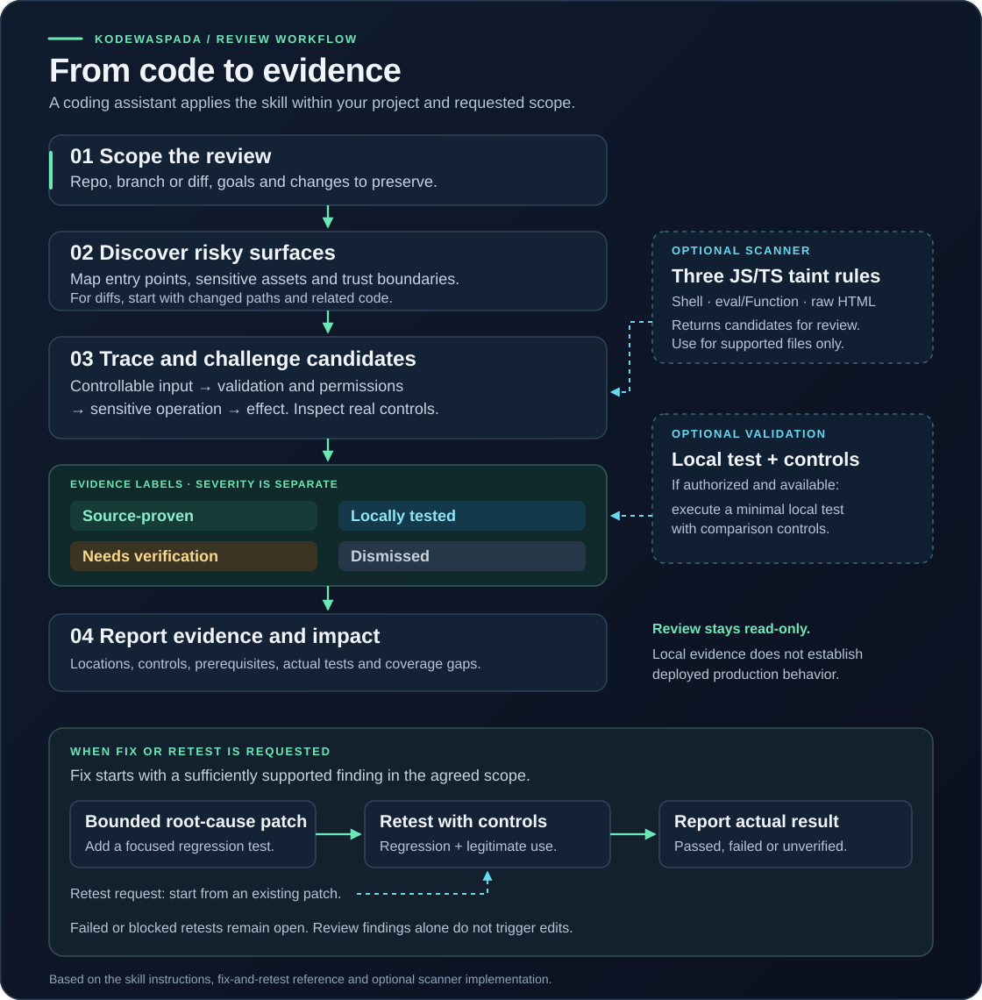
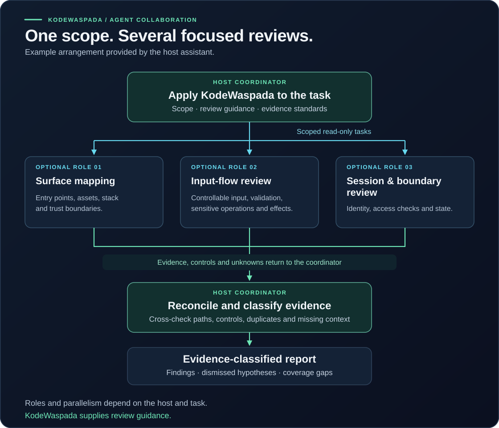

# Visual workflow and source map

[Bahasa Indonesia](VISUAL-WORKFLOW.id.md)

These diagrams explain the workflow defined in the repository. The source map below was checked against commit [`a6308e1`](https://github.com/gustiakmal52/kodewaspada/tree/a6308e18d3aedd203dc228f794f91e5b19213088). Each diagram has a text explanation so its meaning is available without viewing the image.

## 1. Review, evidence, and requested follow-up

The coding assistant reads the KodeWaspada skill and uses the tools available in its session. The skill provides the review process and evidence standard. Python and Semgrep are optional for this primary workflow.

| Step | What happens | Result |
| --- | --- | --- |
| Establish the task | Identify the requested mode, repository or folder, branch or diff, goal, and user changes to preserve. A general safety check starts in Review mode. | A defined scope and permitted actions. |
| Discover risky surfaces | Map entry points, sensitive assets, roles, and trust boundaries. For a diff, follow changed paths into relevant callers, middleware, configuration, and sinks. | Prioritized candidates and an explicit record of coverage. |
| Trace and challenge a candidate | Follow controllable input through transformations, validation, permission checks, the sensitive operation, and the effect. Read helper implementations and check controls that could defeat the hypothesis. | A supported path, a specific evidence gap, or a reason to dismiss the candidate. |
| Validate locally when authorized and available | Execute a minimal synthetic test with a meaningful comparison control. Record observed effects and actual results. | Local evidence for the tested behavior. |
| Report | Explain evidence state, actual source location, supported impact, prerequisites, controls, root-cause guidance, test results, and unexamined areas. | An actionable review with uncertainty preserved. |

### Evidence labels are separate from severity

The four labels describe the available evidence; they are not four mandatory stages of a pipeline.

| Evidence label | When it applies |
| --- | --- |
| **Source-proven** | The reviewed source establishes the input-to-effect path and relevant controls. Runtime or production behavior may remain untested. |
| **Locally tested** | A local test actually ran and recorded both the effect and a meaningful comparison control. |
| **Needs verification** | A plausible candidate is missing required helper, configuration, permission, runtime, or effect evidence. The report names what is missing. |
| **Dismissed** | A real control breaks the suspected path and relevant alternative paths have been considered. The candidate leaves the active finding count. |

Impact and priority are assessed separately using supported reachability and consequences. Neither a source finding nor a passing local test establishes deployed-production behavior.

### Fix and Retest follow the requested mode

When **Fix** is requested, the assistant checks that the finding still applies to the current checkout, inspects relevant callers and contracts, and applies a bounded root-cause patch with regression coverage. A candidate without sufficient evidence needs that evidence resolved before application behavior changes.

When **Retest** is requested, the assistant can start with an existing patch. It executes relevant regression and legitimate-use controls and reports actual outcomes. A failed retest leads to further work within scope or an open issue; an unavailable test remains unverified. Review itself remains read-only. Threat mapping and hardening are other requested modes; proposals are kept distinct from proven findings.

## 2. Collaboration when the host supports multiple agents

This is an **example arrangement supplied by the host coding assistant**. The number of workers, their roles, scheduling, and tool access depend on that host and the task. The repository supplies the skill instructions; `agents/openai.yaml` supplies interface metadata. This illustration does not add an orchestration runtime.

| Example role | Bounded assignment | Material returned to the coordinator |
| --- | --- | --- |
| Surface mapping | Inspect the entry points, stack, sensitive assets, trust boundaries, and relevant project instructions. | Source locations, risky surfaces, dependencies, and coverage gaps. |
| Input-flow review | Trace relevant input handling into database queries, HTML, dynamic execution, or other sensitive operations. | Candidate paths, actual controls, comparison cases, and missing evidence. |
| Session and boundary review | Inspect relevant authentication/session handling and file or data boundaries. | Preconditions, control implementations, supported effects, and unresolved assumptions. |
| Coordinator | Keep assignments within scope, compare overlapping claims, inspect conflicting evidence, and consolidate the outcome. | One report with explicit evidence labels, coverage, actual test results, and next steps. |

The roles illustrate how to divide work; they do not promise that a particular vulnerability class was fully reviewed. Local tests remain subject to the same authorization, runtime availability, and comparison-control requirements as a single-agent review. The skill can also be used by one coding assistant.

## 3. Where the optional scanner fits

The scanner contributes candidate evidence to the review. Its implemented path is:

| Stage | Implemented behavior |
| --- | --- |
| CLI input | Accept a local project and a fresh output directory. Reject invalid targets and existing or symlink output paths. |
| Preparation | Validate the engine location and stage bounded copies of supported JS/TS files in a temporary directory. Record exclusions and staging errors. |
| Analysis | Invoke Semgrep CE with the project's three local taint rules. The target application is not imported or executed. |
| Normalization | Deduplicate candidates, mark each `needs_review`, and record coverage diagnostics and the overall analysis status. |
| Reports | Write JSON, HTML, and Markdown reports when the scan reaches report generation. Early input or prerequisite failures may return without a report. |
| Follow-up review | An assistant or reviewer inspects input control, real safeguards, context, and impact. This evidence assessment is outside the scanner. |

| Rule | Modeled flow | Review still required |
| --- | --- | --- |
| KW001 | Recognized request input to `exec` / `execSync`. | Actual input control, shell context, validation, and reachability. |
| KW002 | Recognized request/URL input to `eval` / `Function`. | Executable context, transformations, controls, and reachability. |
| KW003 | Recognized request/URL input to raw HTML sinks. | HTML/response context, encoding, sanitizer behavior, and reachability. |

Every emitted candidate stays **`needs_review`**, including when analysis is `completed`. The engine-match location is available; `source_line` is currently `None`, so the reviewer must trace the input origin. SQL injection and session review in the collaboration example belong to skill-guided review, beyond these three scanner rules.

| Exit code | Meaning |
| --- | --- |
| `0` | Analysis completed within its selected scope with no candidates. |
| `1` | Analysis completed within its selected scope with candidates to review. |
| `2` | Invalid input/prerequisites, failed analysis, or partial coverage. |

A zero-candidate result is not a security guarantee. Tool failures and unsupported areas remain visible in the final review. See the [scanner guide](SCANNER.md) for supported extensions, exclusions, resource limits, and privacy behavior.

## Source map

| Diagram or explanation | Repository source |
| --- | --- |
| Skill runs inside a coding assistant | [Product model](PRODUCT.md#produk-utama-skill-untuk-sesi-coding) |
| Requested modes and work boundaries | [Mode selection](../skills/kodewaspada/SKILL.md#pilih-pekerjaan-yang-diminta), [work boundaries](../skills/kodewaspada/SKILL.md#batas-kerja) |
| Discovery, tracing, controls, optional tools, local validation | [Evidence-based review](../skills/kodewaspada/SKILL.md#review-berbasis-bukti) |
| Four evidence labels | [Evidence states](../skills/kodewaspada/SKILL.md#status-bukti) |
| Report contents | [Actionable reporting](../skills/kodewaspada/SKILL.md#laporan-yang-dapat-ditindaklanjuti) |
| Requested patch and retest | [Fix and retest reference](../skills/kodewaspada/references/fix-and-retest.md) |
| Scope of agent interface metadata | [Agent metadata](../skills/kodewaspada/agents/openai.yaml) |
| Scanner CLI and exit decisions | [`main()`](../kodewaspada/cli.py) |
| File staging, engine invocation, normalization, coverage | [`_stage()`, `engine_command()`, `_run_engine()`, `normalize()`, `scan()`](../kodewaspada/scanner.py) |
| Candidate reports and three rule definitions | [Report renderer](../kodewaspada/report.py), [rules](../kodewaspada/rules/javascript.json), [rule limitations](../kodewaspada/rules/README.md) |

The SVG files are editable documentation assets with embedded text and no external assets. When behavior changes, compare both diagrams and their explanations with the sources above.
